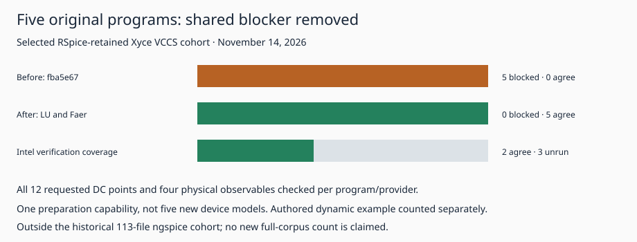

# Five additional original current-source programs — November 14, 2026

Five unchanged original programs now execute every requested DC point and agree
with stock ngspice on LU and Faer. RSpice's existing runner also agrees with
fresh ngspice on all five. These are retained Xyce fixtures in the pinned
RSpice repository, **outside** its historical 113-file `tests/ngspice` cohort.
This is five distinct source programs exercising one preparation capability,
not five new device-model families or a new whole-corpus census.

| Original under `tests/xyce/Netlists/VCCS/` | Before | After, LU and Faer |
|---|---|---|
| `vccs_m.cir` | Unsupported primitive header | All 12 DC points agree |
| `vccs_nl1_m.cir` | Unsupported primitive header | All 12 DC points agree |
| `vccs_nl2_m.cir` | Unsupported primitive header | All 12 DC points agree |
| `vccs_nl3_m.cir` | Unsupported primitive header | All 12 DC points agree |
| `vccs_nl4_m.cir` | Unsupported primitive header | All 12 DC points agree |

Each comparison includes all three physical node voltages and the independent
source's signed branch current: 48 signal-points per program/provider, 480 over
both CPU providers. The largest CPU voltage difference is about `2.85e-14 V`.
Original input hashes, numerical settings, requested coordinates and existing
`1e-6 V`, `1e-9 A`, `1e-4` relative comparison bounds were retained. No input was
replaced, analysis omitted, missing value synthesized, or accepted-time replay
used. The five full original ngspice invocations exit zero too.

The `nl` filenames exercise expression syntax and hierarchy; their actual
current laws are affine. Arbitrary nonlinear current support was not added.

## Shared cause and implemented behavior

The generated parser already recognized these files. The semantic source
profile only admitted a bare linear G tail and did not prepare its M attribute
or CUR expression alias. Two generated semantic profiles now preserve those
fields and their physical source ranges. The ordinary primitive bridge and
existing affine behavioral adapter evaluate them in lexical parameter scope,
then emit the existing typed VCCS/current elements. No Rust equation, native
wire schema, numerical controller or dependency changed.

Explicit positive finite `M` scales every signed coefficient and DC offset.
Differential terms preserve `V(P)-V(N)` and output current flows from P to N.
Malformed, duplicate, unknown, nonfinite and overflowing fields refuse without
publishing partial requests. The grammar-to-implementation catalog now records
the two new profiles and their StrictDoc/test/evidence associations.

Reference investigation used clean pinned
[RSpice source](https://github.com/JaimeHW/RSpice/tree/29c28a022625fd7cc2c56ead1cce2d3066663074):
`crates/rspice-core-netlist/src/netlist/parser/elements.rs` provides behavioral
aliases and source multiplicity, while `netlist/flattener.rs` distinguishes
Xyce's implicit X-line multiplier from ngspice's ordinary declared formal M.
Existing ANTLR, ParameterEvaluator and affine preparation satisfy this bounded
need; a replacement parser or native device implementation would add cost.
No reference implementation source was ported.

Independent native probes confirm the important distinction. With the input
at 12 V, explicit `G M=10` produces -180 V at the output, whereas a declared
but unused nested formal M leaves the output at -18 V. Both levels of nested
scope retain that behavior here. We did not infer Xyce behavior from a folder
name. The effective law is `v(out)=-1.5*M_effective*v(in)` for these fixtures.

## Dynamic example and physical Intel verification

The separate authored
[`controlled-current-multiplier.cir`](../examples/controlled-current-multiplier.cir)
uses both forms, differential control, a current offset and real capacitor
loads. Its OP, three-point DC, three-frequency complex AC and full 1001-sample
transient agree with ngspice on both CPU providers, checking six observables
each. Maximum transient voltage difference is about `5.92e-7 V`, with no startup
omissions. Its explicit one-microsecond maximum step is part of the authored
fixture; it is not another original-default deck count.

The two original root-level forms (`vccs_m` and `vccs_nl1_m`) also agree through
the actual Intel backend across all twelve DC points each; maximum voltage
difference is about `8.53e-14 V`. The required Intel routine passes 13 tests,
and the separate FP64 sparse-kernel probe dispatches on Intel UHD Graphics 630,
driver 31.0.101.2141, seed 18117. The trusted provider hash is recorded. This
does not qualify all five programs on GPU, GPU transient, Linux hardware or a
performance benefit. Keep CPU providers as default.

## Tests, coverage and mutation limits

The RED tests showed five valid-header failures before implementation. The
completed focused suite passes 19 cases, including 13 refusal cases and a
128-case FsCheck property at seed `2026111501`. The property checks fractional
positive multiplicities with signed affine coefficients and offsets.

Full frontend verification passes **996 tests with 40 external-prerequisite
skips**. Full syntax verification passes **531 tests with one link-dependent
skip**, including the 512-case bounded malformed-text property with replay
`362,20261031`. This is library-based randomized malformed-input testing, not
a new coverage-guided or long-running fuzz campaign. Real StrictDoc parsing
accepts **77 documents with 548 unique UIDs**. A fresh-context, read-only code
review found no substantive findings; it is not an external expert review.

Microsoft.CodeCoverage 18.5.1 measured the Frontend/Syntax assemblies including
captured local-function bodies: **10,349/13,016 lines (79.51%)** and
**7,057/10,707 branches (65.91%)**. Mapped source-line counts include
`OperatingPointBridge` **416/422**, `BehavioralSourceLowering` **71/73**,
`BehavioralSourceSyntax` **48/49**, and `PrimitiveSyntax` **84/85**. The separate
syntax-only Coverlet scope measured **7,318/11,270 lines** and **2,751/4,782
branches**. These scopes are not equivalent and were not merged. Native GPU
code was not instrumented, and unchanged Rust code did not receive a new full
coverage/regression campaign beyond the required 13 routine cases.

Stryker.NET 5.0.0 ran in a separate source/build snapshot and selected the two
multiplication assignments. One selected mutant was killed. Its injection
caused definite-assignment compiler errors in larger methods, and safe-mode
rollback marked the other selected site compile-invalid. The raw report has
2,809 compile-error entries, including out-of-filter method rollback entries,
and 3,205 ignored entries; those are not thousands of independently assessed
or killed mutants. The displayed 100% score describes one viable selected
mutant and is not a project-wide score.

The exact skipped fault (`value*=factor` changed to `value/=factor`) was then
independently compiled in the disposable snapshot without Stryker injection.
It caused two focused test failures; restoring the exact source bytes returned
all 19 cases to passing. Production source remained unchanged. This manual
result supplements the framework limitation; it does not rewrite Stryker's
raw CompileError status.

## Reproduction, scope and remaining work

Implementation checkpoint `d43d88b` was committed and pushed to
`fix/deck-blocker-implementation`. The manifest records the tested parent
plus exact source hashes corresponding to this implementation.

Raw artifacts stay at
`E:/Artifacts/Spice-more-decks-fba5e67-20261115T024743Z`.
[`evidence/controlled-current-sources.json`](../evidence/controlled-current-sources.json)
records original hashes, source/runtime correspondence, complete operation
comparisons, test counters, coverage scopes, mutation dispositions and raw
artifact checksums. Before/failed diagnostic attempts are retained separately.
The frozen native engine was reused, not rebuilt for this frontend slice;
51 prior core-source/configuration hashes still match.

Build `Simulator.Frontend.Tests` and `Simulator.Syntax.Tests` with the pinned
SDK, `--artifacts-path` on E:, the existing pinned `AntlrJar` and an E:
`GrammarOutput`. Use `scripts/Run-RequestedCorpus.cs` / `RequestedCorpus.RunAsync`
with the frozen six-row inventory (five originals plus the separate authored
example), exact hashed engine/oracle and a fresh output for each backend.
The recorded full commands and collector settings remain in the manifest/raw
receipt. `current-source-stryker.json` selects character spans tied to this
source; regenerate and review them if those lines move or line endings change. Reproduce manual
faults only in a verified disposable snapshot, then rebuild after restoring.

The qualified source profile remains positive explicit multiplicity and affine
CUR only. Nonpositive multipliers, general nonlinear current expressions,
E VOL aliases, other attributes and special implicit hierarchy multipliers
remain outside this slice. The historical ngspice cohort did not receive a new
full simulation census, and no progress is claimed for it from these five.
Console print formatting, full Xyce semantics and arbitrary model compatibility
are not inferred from structured numerical results. Requirements remain Draft.
Canonical main, unrelated sheet-resistor work and VeloSim were preserved; no
CI or new endurance campaign was launched.
