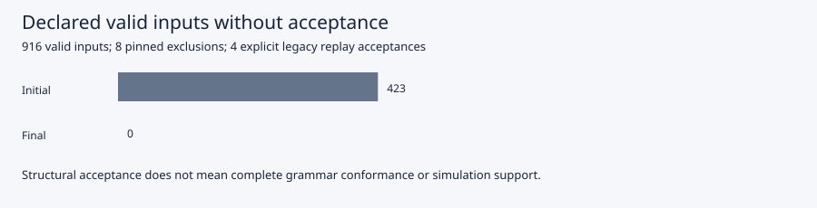

# Parser-only frontend: results and remaining work

## Delivered boundary

The [three-reference assessment](parser-only-plan.md) compares ngspice's C
frontend/device readers, XDM's C++ Boost.Spirit grammars and SpiceSharpParser's
C# BNF/lexer/parser. **ANTLR 4.13.1** supplies the generated C# lexer and parser.
The handwritten code supplies resource policy, physical source locations,
immutable statement records and structured diagnostics. It does not implement a
second recognition engine. See [grammar inventory](parser-grammar-inventory.md)
and [dependencies/licenses](parser-dependencies.md).

`Simulator.Syntax` references no simulator. Includes are not loaded, model names
are not resolved, control commands do not run and analyses do not execute.
Syntax records retain original spelling/ranges, including continuation trivia;
the generated parse tree drives statement recognition. Rich elaborated model
objects and the Rust lowering adapter are future work. The current production
bounded importer is unchanged.

## Final full sample campaign

All **910 upstream inventory rows plus 14 tracked repository SPICE samples** were
attempted: **924/924**, no budget-unattempted inputs. The full bounded row report
is `evidence/parser-only-corpus.json`; it includes input hashes where available,
source/DLL hashes, actual corpus HEAD, inventory revision, timings and bounded
diagnostics. The final checkpoint tree was dirty at base 054c3ee; scoped source hashes,
rather than that base alone, identify the tested implementation.

| Outcome | Upstream | Repository | Total |
|---|---:|---:|---:|
| Structurally accepted | 479 | 14 | 493 |
| Explicit grammar gap | 181 | 0 | 181 |
| Rejected by current grammar | 231 | 0 | 231 |
| Resource rejected | 7 | 0 | 7 |
| Worker timeout | 8 | 0 | 8 |
| Encoding rejected | 4 | 0 | 4 |

`syntax_rejected` does **not** independently establish that an upstream deck is
malformed. `accepted_structure` does **not** establish complete device-parameter
validation, full ngspice conformance or numerical support. Quoted expressions,
control bodies and some directive/parameter tails have deliberately documented
structural validation only. The four UTF-8 refusals are not invalid-circuit
judgments. Oversized/deep inputs and timeouts are unavailable coverage.



The chart is a parser-specific series. The first implementation accepted 399
inputs; common grammar fixes raised that to 493 and moved unsupported families
into explicit gaps. Numerical corpus history and simulation-support counts are
not changed by these results. The earlier SpiceSharpParser trial used a different
grammar/settings scope; its 488/910 count is not a comparable conformance score.
The preceding post-review run accepted 494, with two timeouts and eleven resource
rejections. The final checkpoint rebuild/replay accepted 493 under the same
three-second worker budget: `positive-definite-1.cir` became a timeout, and four
deep inputs timed out before reaching their resource guards. These are
availability differences, not adjudicated grammar regressions or passing cases.

## Verification and review

- 60 xUnit/FsCheck tests passed, zero skipped. Properties ran 128 generated
  valid cases (replay `192,20261031`) and 512 malformed-text cases (replay
  `362,20261031`). No minimized failure remains from these finite properties.
- CLI regression campaigns exercise valid unsupported models, malformed input,
  invalid UTF-8, missing/oversized input, unary/mixed grammar recursion, actual
  revision recording and an intentional copied-binary hash change. The latter
  must end `provenance_changed` with a nonzero exit, not qualify the run.
- Coverlet 10.1.0 measures generated and handwritten syntax code separately.
  Handwritten syntax: 107/107 lines, 83/90 branches. Generated recognizer:
  2066/2983 lines, 303/454 branches. These are scoped metrics, not evidence that
  all language productions or dialects are correct.
  `dotnet-coverage` 18.12 measures the real CLI and its integration driver;
  exact line/branch counts and Stryker outcomes are in
  `evidence/parser-only-verification.json` and `evidence/parser-only-cli-verification.json`.
- Stryker.NET 5.0 mutates handwritten C# boundary code only. It does not mutate
  the ANTLR grammar or generated recognizer. Survivors, uncovered mutants,
  compile errors and timeouts remain distinct; none is silently treated as a kill.
  The broad run recorded 123 killed, 34 survived, three uncovered, one timeout,
  28 compile errors and six ignored. A stronger combined-recursion assertion
  then killed four of five selected guard mutations (one boundary survivor).
  Two previously missed guard mutations were killed by that replay. The
  [bounded mutation ledger](../evidence/parser-only-mutation-backlog.json)
  retains original outcomes and replay dispositions separately; 33 survivors,
  two uncovered cases and one timeout remain open after the focused replays.
  Full-run and focused counts must not be added together.
- Real StrictDoc 0.30.4 parsed 16 documents, 299 stable IDs and 287 resolved
  parent links in the intended requirements snapshot. Sphinx 9.1 built that
  snapshot with warnings as errors. The unrelated local sheet-resistor draft
  NGC-039 was excluded and remains preserved/unqualified. PRS-001 through
  PRS-004 and NGC-PARSE requirements remain Draft, not broad closure.

An independent AI code reviewer identified unbounded unary/hierarchy recursion,
mutable executable provenance and an unverified corpus revision. Fixes added
pre-token recursion limits and a generic ANTLR rule-depth listener, rechecked DLL
hashes and actual Git HEAD recording. Follow-up source review found no remaining
blocking finding. This was automated source review, not an external human audit.
End hash checks address ordinary concurrent changes, not malicious transient
tampering followed by byte restoration.

Initial tests deliberately failed before implementation. Expanded tests then
found include-path, unknown-family classification, nesting-underflow, bare-CR
location and function-assignment gaps before the corresponding fixes.
One intermediate campaign stopped at a 200-row checkpoint when disk filled;
the final campaign is a fresh complete retry. A mutation startup also failed
for disk space. Those attempts remain local and are not passing evidence.
Supported Cargo/NuGet cache cleaners reclaimed generated build/HTTP caches;
source, raw campaign logs and installed packages were preserved.

## Highest-value next grammar work

1. **XSPICE device/port grammar:** the final rejection's first offending token
   was `%` in 61 decks; many A-device families are explicit gaps. Implement
   typed ports, inversion and array connection productions as a family.
2. **Identifier and dialect spelling:** signed/hyphenated/bus identifiers,
   context-sensitive name/expression boundaries and library paths/sections.
3. **Detailed source/directive expressions:** POLY/TABLE and waveform clauses,
   measurement/conditional/library productions and distinct expression contexts.
4. **Remaining device families:** P/Y/U/N transmission/semiconductor forms,
   model-dependent terminal interpretation and parameter grammar inventories.
5. **Adjudication and stronger recognition evidence:** separate non-deck scripts
   and invalid fixtures from missing productions; qualify embedded quoted/control
   languages; add grammar-production mutation/differential tests. Larger/deeper
   decks and Linux remain unqualified.

First-diagnostic counts are overlapping prioritization clues, not an exhaustive
feature-demand count. Every bounded row is retained so common causes can be
minimized and replayed without relying on a failed numerical run.

## Reproduction

From an existing checkout, PowerShell (Windows or Linux with `pwsh`):

```powershell
$repository = (Get-Location).Path
if (!(Test-Path -LiteralPath (Join-Path $repository 'scripts') -PathType Container)) { throw 'Run from checkout root' }
./scripts/Initialize-SyntaxParser.ps1
./scripts/Test.ps1 -SyntaxOnly
dotnet test ./dotnet/Simulator.Syntax.Tests --collect 'XPlat Code Coverage'
./scripts/Run-SyntaxCorpus.ps1 -CorpusRoot '<existing ngspice Git checkout>'
dotnet run --file ./scripts/Test-SyntaxCorpus.cs -- $repository
dotnet tool run dotnet-stryker -- --config-file dotnet/Simulator.Syntax.Tests/stryker-config.json --test-project dotnet/Simulator.Syntax.Tests/Simulator.Syntax.Tests.csproj --output work/syntax-stryker
```

Java 11+ and the repository-pinned .NET SDK are prerequisites. The setup command
downloads/checks the generator; subsequent generation is incremental under `obj`.
The corpus script creates an ignored `work` output directory after checking its
parent. For a specific inventory/output, use `-Inventory` and `-Output` (existing
output parent required). These commands launch no numerical simulator, CI, soak
or automatic issue upload. This session's result issue is a separate authorized
publication. No new Rust numerical, Linux, GPU, NativeAOT or performance
qualification is claimed.

The ordinary `scripts/Test.ps1` now includes the syntax unit suite before its
existing numerical checks. `-SyntaxOnly` executes that suite without numerical
work; add `-SyntaxCorpus -CorpusRoot <checkout>` to include the sample campaign.
The full numerical orchestration was not rerun for this parser-only change.
