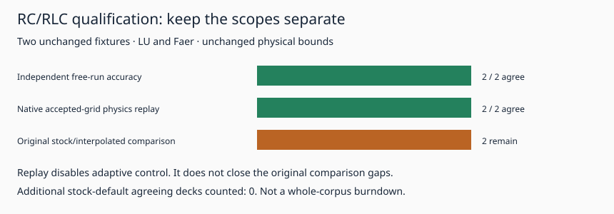

# RC/RLC transient reference study — November 14, 2026

The large reported differences did not establish an R/L/C equation defect.
Both free-running engine traces satisfy the existing bounds against independent
closed-form ramp solutions. Replaying the native accepted grid also makes both
circuits agree with ngspice on LU and Faer. These are different checks and remain
separate evidence.

## Diagnosis and reference behavior

The previous comparison linearly interpolated ngspice's coarser samples onto our
adaptive times. Interpolation error and different integration step sequences
were being interpreted as a possible physics gap. The original strict comparison
is retained; it has not been relabelled as passing or given looser bounds.

Pinned [RSpice](https://github.com/JaimeHW/RSpice/tree/29c28a022625fd7cc2c56ead1cce2d3066663074)
handles pointwise execution comparison by locking its engine to the reference
grid. See `tools/rspice-conformance/src/suites/execution/run.rs`, the transient
branch around lines 405–428, and `suites/ngspice/time_analyses.rs` around lines
35–62. Measure-based and INTERP contracts have separate paths. Its passing RC/RLC
results were therefore controlled-grid physics evidence, not proof that its
free-running integrator was more accurate. Source inspection informs this
interpretation; the reused binary was not rebuilt in this task.

The independent references solve these named physical circuits over the rising
0–1 V ramp in the first microsecond:

- RC: `v(out) = t/tau - 1 + exp(-t/tau)`, `tau = 1 us`; source current is
  `-(v(in)-v(out))/1 kohm`. A short series avoids cancellation near zero.
- RLC: `LC*v'' + RC*v' + v = k*t`, with zero initial voltage/current,
  `k = 1e6 V/s`, `R = 100 ohm`, `L = 1 mH`, `C = 1 nF`.
  The closed-form damped sine/cosine solution gives capacitor voltage,
  `i(L)=C*v'`, `v(mid)=v(in)-R*i(L)` and signed source current `-i(L)`.

The F# reference validates the actual lowered circuit, waveform, case identity,
complete time domain and every signal's identity/units before evaluating data.
It reuses the strict RAW reader rather than implementing another input parser.
Changing the physical parameter, deleting values or corrupting units refuses
without publishing a result. It is not a general nonlinear/model oracle.

## Measured outcomes

All checks retain `1e-6 V` absolute, `1e-9 A` absolute and `1e-4` relative bounds.
All voltages, source currents and the RLC inductor current are checked; no
startup samples are discarded.

| Check | RC | RLC |
|---|---|---|
| Free-running engine versus closed form | All 149 samples agree | All 206 samples agree |
| Maximum free-running output-voltage error | about `5.07e-7 V` | about `3.57e-7 V` |
| Native-grid physics replay, LU and Faer | All 108 native times agree | All 112 native times agree |
| Approximate maximum replay voltage error | `1.00e-8 V` | `4.04e-9 V` |
| Original strict free-run/native interpolation | Disagreement retained | Disagreement retained |

Stock ngspice's own RLC voltage samples miss the analytical application bound at
40 points in this study, while our retained free-run samples do not. This does
not imply incorrect ngspice equations: a coarse stock trajectory is not an exact
oracle under an independently chosen tighter pointwise acceptance budget.
The original interpolation discrepancies remain about `1.16e-5 V` for RC and
`1.30e-5 V` for RLC. Controlled replay isolates physics from that uncertainty.

The existing RSpice runner was also rerun against fresh ngspice output on the
unchanged fixtures and reports agreement for OP, AC and transient. Its time
control scope above must accompany that result. No standalone RSpice timing or
fresh clean RSpice build is claimed. The raw launcher summary described the
invocation as “no grid locking”; source inspection showed the runner enables
that behavior internally. That raw annotation is incorrect and is explicitly
corrected in the evidence, with the original artifact preserved.

## Changes

`TransientConfiguration.AcceptedTimesS` / `accepted_times_s` is an optional
explicit linear replay control. It requires a finite strictly increasing grid
from zero through stop, honors the original step ceiling and recording budget,
and is exclusive with adaptive control. Missing source corners, unsupported
nonlinear replay and oversized recordings fail before publication. Ordinary
requests still select their existing adaptive/fixed controller.

`ReferenceGridReplay` preserves the original request and constructs a separately
identified replay. It refuses UIC, reporting windows, unresolved initial
conditions and unsupported models. Returned samples must exactly match the grid
and report `integration.time_control = accepted_time_grid` before the general
comparator runs. A constant waveform on a different grid is a regression case:
numerical interpolation alone would falsely pass it.

The script also requires baseline managed-assembly identity, validates the
actually loaded assemblies, compares the regenerated request with its archived
baseline before dispatch, and checks input/runtime hashes afterward. Replay is
explicitly **not** an additional stock-default or adaptive-controller pass.

Exact grid testing exposed a separate genuine JSON-boundary defect: the default
serde_json parser displaced `1.0840005611200061e-10` by one ULP. Enabling the
existing pinned dependency's `float_roundtrip` feature preserves the standard
binary64 value. The test failed before the change and passes afterward. This
does not explain the much larger interpolation gaps. See `decimal-roundtrip.sdoc`
and `evidence/decimal-roundtrip.json`, checkpoint `26879bf`.

The full suite also exposed the pre-existing inclusive recording-limit bug:
fixed runs reserved an adaptive midpoint they never retained. Fixed/explicit
steps now reserve one endpoint, adaptive steps two samples, under the unchanged
two-million-scalar limit. Explicit grids preflight their total before emitting
any sample. Stale tests rejecting already supported trapezoidal operation and
linear AC at zero frequency were replaced with physical/contract assertions;
production model and AC equations were not changed for those tests.

## Build-cache recovery

A post-mutation full-suite attempt retained an accepted-grid test artifact that
failed the omitted-corner guard despite unchanged correct source. The linked
engine passed the separately added negative executable test. Invalidating the
owned package with `cargo clean --package circuit-simulator` removed 17,333 E:
cache files (10.9 GiB); rebuilding the unchanged source made all six grid tests
pass. The final checkpoint repeats qualification after rebuilding. These facts
identify an unsafe shared-cache workflow; no underlying Cargo/compiler defect
is claimed. Source hashes alone were insufficient executable evidence.

Mutation snapshots must use separate mutable output caches. The permanent
linked-engine negative regression accompanies the positive replay tests.
Failed cached and setup attempts remain local and are not passing evidence.
The final build disables incremental compilation; vendor dependencies are
reused and bulk outputs stay on E:.

## Final verification

- Rust: **625 passed, 5 ignored, zero failed** after owned-cache invalidation.
  Ignored cases require the BSIM/SOI hosts, a separate Gummel–Poon oracle setup,
  or the bounded endurance launcher. No new soak was run.
- Managed: **977 passed, 40 prerequisite-dependent skips, zero failed**. This
  includes four full native-grid comparisons and the linked-engine corner guard.
- Replay helper: **6 Pester tests passed**; **145/159 commands (91.19%)** covered.
- Targeted mutation: **3/3 selected guard mutants caught**, zero survivors,
  timeouts or invalid candidates. This is not a whole-project mutation score.
- Randomized checks: **64 Rust Proptest cases**, seed `2026111406`; **64 FsCheck
  cases**, seed `2026111405`. Three analytical malformed-fixture cases refuse
  changed parameters, missing values and incorrect units without publishing.
- Real StrictDoc parsing: **76 files, 546 unique UIDs**, no duplicates.
- Required Intel circuit/provider/CLI routine: **13 tests passed**, including
  real RC accepted-grid comparison against LU. The separate physical sparse
  probe also dispatched successfully on Intel UHD 630, driver 31.0.101.2141.
  Neither establishes arbitrary GPU transient or Linux qualification.

Coverage scopes are deliberately separate. The full managed suite measured
**22,162/28,010 lines (79.12%)** and **6,702/10,471 branches (64.00%)**.
The named Rust `accepted_time_grid` instrumentation measured **1,058/8,132 owned
library lines (13.01%)**; `src/configured.rs` was **171/348 (49.14%)**. That run
excludes other tests, executable main and vendor code, and leaves nonlinear and
adaptive paths largely unmeasured. Stable Rust branch coverage was unavailable.
Native GPU code was not instrumented. Coverage alone does not prove correctness.



## Reproduction and evidence

Verified implementation checkpoint: `e44aefd`; JSON round-trip checkpoint:
`26879bf`. Both were pushed to `fix/deck-blocker-implementation`. The
bounded manifest records tested parent plus exact source hashes; documentation
and evidence are committed separately.

Raw root: `E:/Artifacts/Spice-RC-RLC-76d5a20-20261115T011507Z`.
Earlier attempts, including the four exact-coordinate failures before the JSON
fix, are retained rather than overwritten. Final commands, hashes, coverage,
test counts, mutation outcomes and limitations are recorded in
`evidence/rc-rlc-transient.json`.

Build with the pinned toolchains and the repository's supported E: output flags.
First run the ordinary corpus coordinator for the two unchanged fixtures; keep
its results even when the original interpolation comparison disagrees. Then:

```powershell
if (!(Test-Path -LiteralPath $repository -PathType Container)) { throw 'Missing source' }
if (!(Test-Path -LiteralPath $baseline -PathType Container)) { throw 'Missing completed baseline' }
if (!(Test-Path -LiteralPath $artifactRoot -PathType Container)) { throw 'Missing E: artifact root' }
& (Join-Path $repository 'scripts/Compare-TransientGridReplay.ps1') -ManagedBin $managedBin -Engine $engine -BaselineDirectory $baseline -OutputDirectory $freshReplay
$references = @('Antlr4.Runtime.Standard','Simulator.Client','Simulator.Syntax','Simulator.Frontend','Simulator.RequestedQualification') | ForEach-Object { '--reference:' + (Join-Path $managedBin ($_ + '.dll')) }
dotnet fsi @references --exec (Join-Path $repository 'scripts/RampTransientReference.fsx') $baseline $freshAnalyticalJson
```

`examples/rc-accepted-grid.json` demonstrates the wire option on a deliberately
coarse grid. Its purpose is provider/control parity, not global waveform accuracy.
The routine Intel contract compares that actual RC replay with LU as well as
its prior circuit/property checks. The separate physical sparse-kernel probe
remains required. No GPU speedup, nonlinear replay, full-SPICE or Linux hardware
qualification is inferred.

Requirements remain Draft in `transient-reference-grids.sdoc` and
`decimal-roundtrip.sdoc`. No new ordinary stock-default agreeing deck is counted.
Canonical main, its unknown work and the schematic project remain untouched.
