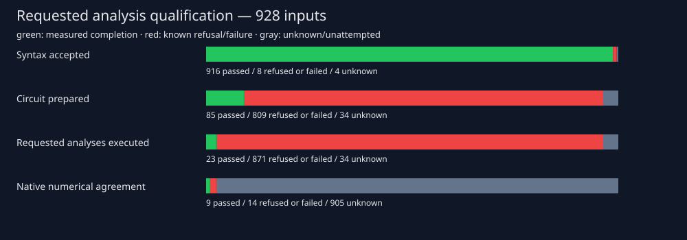

# Original requested-analysis census and identity replay

## Current full inventory: fc5db25

The [fresh 928-input census and ranked shared blockers](requested-corpus-fc5db25.md)
supersedes the measurements below: 81 prepared, 21 requested executions and 9
ngspice agreements, with matching provenance. Four GND-sensitive preparation
admissions are now correctly refused; four original BJT executions still fail.
See the new report for overlapping root/content counts and unavailable evidence.

## Historical full inventory: f64edbd

Results task: [shared blockers and remaining failures, #29](https://github.com/jeffadickson/Spice/issues/29).
The final frozen run completed in 834.140 seconds with matching provenance.

| Stage | Passed | Refused/failed | Unknown |
|---|---:|---:|---:|
| Syntax | 916 | 8 | 4 |
| Physical preparation | 85 | 809 | 34 |
| Original requested execution | 23 | 871 | 34 |
| Native numerical agreement | 9 | 14 | 905 |

The earlier full run below prepared 77, executed 18 and agreed 4 on the same 928
inventory. These are original individual requested analyses, not complete control
programs or selected OP probes. The latest 23 executions include nine agreeing
rows and 14 unqualified rows: ten stateless sine/gain interpolation discrepancies,
two `v(gnd)` gaps subsequently diagnosed as floating-ground topology errors,
the simple-meas transient discrepancy and the RC-ramp
backward-Euler accuracy discrepancy. No tolerance was relaxed. A subsequent
correction explicitly refuses active `gnd` references until dialect-aware alias
normalization is qualified. Both original affected decks now refuse before
simulation; the frozen 23/9 counts above are historical, not a new count after
that guard. See `ground-alias-admission.sdoc`.

Four additional original BJT amplifier transient attempts (spice3.deck and
xspice_c1.cir, with mirrors) failed with `Newton iteration limit exceeded`.
They are execution failures, not numerical disagreements or completed solves.
The finite composite recovery tests do not close these real-circuit failures.
The [bounded public-API diagnosis](bjt-corpus-initialization.md) separates initial
OP recovery from a later LU residual refusal; an explicit faer warm start completes
the200steps, without claiming native waveform agreement or reclassifying the
original requests.

Common diagnostic occurrences include 272 unsupported physical directives,
139 XSPICE models, 78 MOS profiles, 39 BJT profiles, 43 source profiles and 23
resistor profiles. Diagnostics overlap and cannot be summed as distinct decks.
Among physically prepared decks, unsupported controls dominate the remaining
request refusals. This motivates shared semantics/model work rather than separate
patches for each sample. 22 resource refusals, four strict UTF-8 failures and eight
pinned exclusions remain unavailable downstream evidence.

Bounded [manifest](../evidence/requested-final-f64edbd.json) records individual
executed paths, operation outcomes, grouped diagnostics and raw checksums. Raw
requests/results/native projections remain on E:. No new Linux, GPU, SpiceSharp
third-reference, speed parity or production qualification is claimed.

## Earlier full run and targeted identity replay

Results tasks: [full campaign #27](https://github.com/jeffadickson/Spice/issues/27)
and [targeted replay #28](https://github.com/jeffadickson/Spice/issues/28).

The frozen 928-input campaign tested `62ae97d` for 1,365.758 seconds and completed
with matching source, engine, input and resource provenance. It executes individual
original requested analyses, rather than substituting a selected operating point.
It does not claim complete control-program compatibility.

| Stage | Passed | Refused/failed | Unknown |
|---|---:|---:|---:|
| Syntax | 916 | 8 | 4 |
| Physical preparation | 77 | 817 | 34 |
| Original requested execution | 18 | 876 | 34 |
| Native numerical agreement | 4 | 14 | 910 |

The four unreadable inputs have non-UTF-8 bytes. The other unavailable downstream
results include 22 resource refusals and eight hash-pinned exclusions. Preparation
is not a solve. Among the 59 physically prepared inputs whose requests did not
execute, 56 had unsupported control programs, two had no requested analysis and
one had an unqualified overlapping pulse. These are common causes, not 59 separate
parser defects. The bounded modeled-control implementation is a later checkpoint.

The 18 executed inputs exposed two different comparison problems. Auxiliary bias
sources were being mapped to invented native names such as `a1$offset#branch`.
Typed original branch identities now prevent that mistake, including collisions
with legitimate original names containing `$offset`. Separately, ten sine/gain
inputs and one RC ramp show transient discrepancies at the unchanged voltage and
current tolerances. Native-grid interpolation and backward-Euler discretization
need qualification; these discrepancies are not silently reclassified as passes.

A separate 18-input replay tested `408d718` for 28.883 seconds with a separately
copied engine and matching provenance. All 18 parsed, prepared and executed;
seven agreed and 11 retained numerical disagreements. The invented observable
gaps are gone. This is a targeted cohort, not a new 928-input campaign and not a
whole-product regression claim.

The seven agreeing paths are recorded individually in the bounded replay manifest.
The earlier selected-OP results used different analyses and comparison scopes;
they must not be compared directly with these requested-analysis counts.

Evidence: [full manifest](../evidence/requested-corpus-62ae97d.json) and
[cohort manifest](../evidence/requested-cohort-408d718.json). Raw requests, native
projections, actual results, checksums and failure logs remain in the E: directories
identified by those manifests. Both campaigns used the frozen ngspice inventory
from `e8285746c73a8229cf922487c8ccfcf6bea61bce`. No fresh Linux or SpiceSharp third
reference execution is implied by these campaigns.
