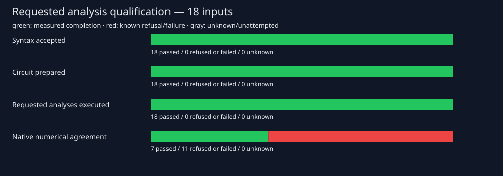

# Original requested-analysis census and identity replay

Results tasks: [full campaign #27](https://github.com/jeffadickson/Spice/issues/27)
and [targeted replay #28](https://github.com/jeffadickson/Spice/issues/28).

The frozen 928-input campaign tested `62ae97d` for 1,365.758 seconds and completed
with matching source, engine, input and resource provenance. It executes individual
original requested analyses, rather than substituting a selected operating point.
It does not claim complete control-program compatibility.

| Stage | Passed | Refused/failed | Unknown |
|---|---:|---:|---:|
| Syntax | 916 | 8 | 4 |
| Physical preparation | 77 | 817 | 34 |
| Original requested execution | 18 | 876 | 34 |
| Native numerical agreement | 4 | 14 | 910 |

The four unreadable inputs have non-UTF-8 bytes. The other unavailable downstream
results include 22 resource refusals and eight hash-pinned exclusions. Preparation
is not a solve. Among the 59 physically prepared inputs whose requests did not
execute, 56 had unsupported control programs, two had no requested analysis and
one had an unqualified overlapping pulse. These are common causes, not 59 separate
parser defects. The bounded modeled-control implementation is a later checkpoint.

The 18 executed inputs exposed two different comparison problems. Auxiliary bias
sources were being mapped to invented native names such as `a1$offset#branch`.
Typed original branch identities now prevent that mistake, including collisions
with legitimate original names containing `$offset`. Separately, ten sine/gain
inputs and one RC ramp show transient discrepancies at the unchanged voltage and
current tolerances. Native-grid interpolation and backward-Euler discretization
need qualification; these discrepancies are not silently reclassified as passes.

A separate 18-input replay tested `408d718` for 28.883 seconds with a separately
copied engine and matching provenance. All 18 parsed, prepared and executed;
seven agreed and 11 retained numerical disagreements. The invented observable
gaps are gone. This is a targeted cohort, not a new 928-input campaign and not a
whole-product regression claim.

The seven agreeing paths are recorded individually in the bounded replay manifest.
The earlier selected-OP results used different analyses and comparison scopes;
they must not be compared directly with these requested-analysis counts.

Evidence: [full manifest](../evidence/requested-corpus-62ae97d.json) and
[cohort manifest](../evidence/requested-cohort-408d718.json). Raw requests, native
projections, actual results, checksums and failure logs remain in the E: directories
identified by those manifests. Both campaigns used the frozen ngspice inventory
from `e8285746c73a8229cf922487c8ccfcf6bea61bce`. No fresh Linux or SpiceSharp third
reference execution is implied by these campaigns.
