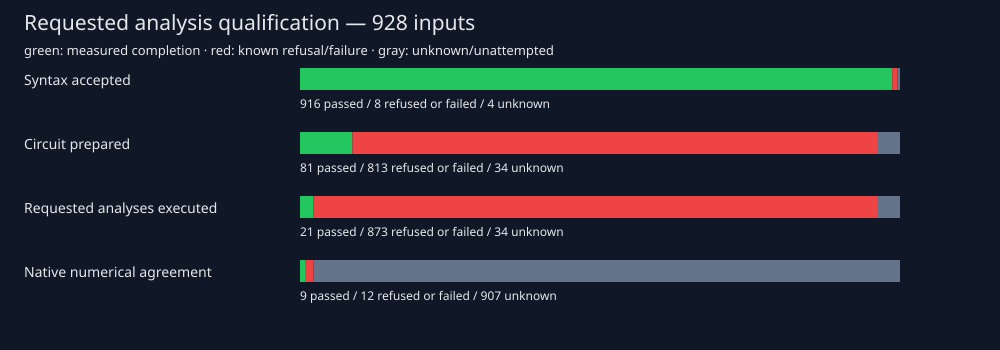

# Full corpus census and shared blockers — November 3

The frozen **928-input** run completed in **957.417 seconds** on
`fc5db2529abace539f23ba3aa35508af2c78b62e`, with matching final provenance.
**21 inputs executed their original requested analyses; 9 agreed with ngspice.**
This is still a small executable subset, not a compatible SPICE implementation.
No simulator feature or tolerance changed during this reporting task.

Results and prioritized fix checklist: [GitHub issue #34](https://github.com/jeffadickson/Spice/issues/34).

| Stage | Passed | Known refusal/failure | Unknown/unavailable |
|---|---:|---:|---:|
| Original syntax | 916 | 8 | 4 |
| Physical preparation | 81 | 813 | 34 |
| Original requested execution | 21 | 873 | 34 |
| ngspice numerical agreement | 9 | 12 | 907 |



Preparation is not execution. A refusal is not proof that an upstream sample is
invalid. The denominator includes model/include fragments and programs outside
the bounded requested-analysis profile. Of 910 upstream input paths, 17 executed
and six agreed; of 18 repository paths, four executed and three agreed. Across
both groups, these are 15 distinct original content hashes executed and eight
agreed. Equal original bytes do not imply equal resource environments.

The raw campaign retains every requested operation, coordinate, observable,
omission, response and original native projection. It compares mapped root
voltages and supported branch currents, with the existing tolerances. It does
not run arbitrary input-control programs or establish measurement-language parity.

## What changed from the preceding full run

The historical `f64edbd` census prepared 85 / executed 23 / agreed 9. Exact root matching
finds four preparation changes, all caused by the explicit `gnd` admission guard:
`examples/measure/rc-meas-ac.sp`, `rc-meas-ac-control.sp`, and their
`paranoia_parallel` counterparts. The two ordinary AC decks previously executed
with the wrong floating-ground topology; they now refuse. The control variants
were already request-refused. The agreement count remains nine.

This is stricter, more honest admission, not new ground-alias support. Twenty-one
roots currently reach `unsupported_ground_alias` (19 distinct original hashes).
Later Newton fixes did **not** make the four original BJT amplifier attempts pass.

## Ranked reach of observed structural gaps

The existing generated parser and bounded `CircuitReadiness` audit examined 894
expanded inputs, representing 791 unique expanded texts. The reporting helper
verified 57 original source/project/grammar entries against the frozen run and
requires the full parser/frontend/client source manifest and identical baseline
root identities. Case-insensitive `.option`/`.options` spellings share one group.

| Observation | Distinct root inputs | Unique original hashes | Sole observed structural issue |
|---|---:|---:|---:|
| MOS profile contract | 218 | 208 | 28 |
| Unsupported active XSPICE family | 206 | 165 | 124 |
| Options directive policy | 180 | 173 | 7 |
| BJT profile contract | 116 | 110 | 34 |
| MOS binding/model contract, overlapping the MOS row | 88 | 88 | 0 |
| Diode profile contract | 71 | 66 | 6 |
| Voltage-source waveform/profile | 65 | 52 | 9 |
| Initial-condition directive policy/context | 58 | 51 | 10 |
| `.csparam` directive/deferred evaluation | 42 | 39 | 0 |
| Resistor primitive header/profile | 41 | 38 | 9 |
| OSDI active family | 30 | 30 | 23 |
| Temperature directive policy | 23 | 21 | 0 |

These are overlapping observations, not predicted successful solves. For example,
87 roots have both MOS-profile and options observations; 48 have both BJT-profile
and options observations. The 88 MOS binding observations are already inside the
218-profile group. An initial-condition observation in the static audit can need
analysis-specific treatment, rather than indicating that all `.ic` support is
missing. Model-family presence alone never becomes a missing-model verdict.

The audit marks 89 active graphs incomplete and 22 observation sets truncated.
Those limits overlap; absence of further issues is not exhaustive scalar,
parameter, elaboration or numerical validation. Even a sole observed issue is
not a guaranteed unlock.

Reached primary refusals give a different view: 272 roots reach an unsupported
physical directive, 139 an XSPICE-model refusal, 85 an active-card refusal and 76 a
MOS-profile refusal. These are first reached diagnostics, so later problems can
remain hidden. The bounded manifest retains both rankings and examples.

## Recommended engineering order

1. **Recover the already near-executable cohort.** Qualify dialect-aware ground
   normalization, then the original BJT transient initialization failures.
   Replay the four ground-affected inputs and all four BJT paths against ngspice.
   Keep the existing terminal convergence and observable checks.
2. **Shared analysis/directive semantics.** Of 81 physically prepared roots,
   56 still have refused requests. Their reached groups include 16 `let`, nine
   unsafe/mixed control forms and eight `define` cases. Model only bounded typed
   operations; never execute arbitrary upstream scripts. In parallel, classify
   the 180 options observations into numerical settings and reporting settings.
   Do not silently ignore numerical options or promise 180 new simulations.
3. **Explicit semiconductor profiles.** The 218 MOS, 116 BJT and 71 diode roots are
   the largest shared model-contract groups. Name the actual levels, parameter
   sets and charge laws before extending them; qualify DC, AC and transient
   behavior end to end. Apply the reuse/integration gate to larger existing model
   families rather than treating each failed deck as a parser patch.
4. **Measured XSPICE and behavioral subsets.** The 206 active XSPICE observations
   include digital/event examples such as `digital/auto_bridge/adder_auto.cir`.
   This is a separate compatibility project, not one missing model switch.
   Inventory named families/ports and evaluate existing integrations before
   committing to a broad implementation.
5. **Close comparison and resource gaps without waivers.** Requalify the 12
   disagreements and retain explicit handling for 22 resource refusals, four
   strict UTF-8 failures and eight hash-pinned exclusions. None is downstream
   passing evidence.

This order combines likely shared fixes with existing executable evidence;
the structural table above remains the independent ranking by observed reach.
Steps1–2 of the user's current request were measurement and prioritization;
the simulator work listed here is follow-up, not implemented by this checkpoint.

## Actual execution failures and disagreements

Four requested transient executions still return `numerical_failure` /
`Newton iteration limit exceeded`: original `spice3.deck` and `xspice_c1.cir`,
plus their parallel mirrors. The manifest retains their actual response paths.

Twelve completed inputs remain numerically unqualified. Ten are the previously
diagnosed stateless sine/gain interpolation cohort; their current primary status
still remains numerical disagreement. The other two are `simple-meas-tran.sp`
and `qualification-rc-ramp.cir`. The current simple-meas maximum differences
include 0.000397890714 V and 3.978907141 nA. Historical independent identity probes
are supporting diagnosis, not permission to waive this run's comparisons.
No tolerance was relaxed and no failed comparison became an agreement.

## Evidence, verification and reproduction

Bounded [manifest](../evidence/requested-fc5db25.json),
[reporting verification](../evidence/corpus-ranking-verification.json) and chart
are versioned. Raw artifacts remain local under
`E:/Artifacts/Spice-census-20261103T191728Z`; the full structural audit is 42 MB and
is deliberately outside Git. The immutable source checkout is
`C:/dev/spice-census-fc5db25`; upstream corpus commit is
`e8285746c73a8229cf922487c8ccfcf6bea61bce`, ngspice 47+.
The copied qualified engine has SHA256
`42835c20d6ee316cb88b656849e0f5a6b18272d89fedc2ca62420c7a206caaab`.
Its producer's native source matches the tested commit; no cold native rebuild
or performance-speedup claim is made.

Reporting checks: 10 managed tests pass, including 200 FsCheck aggregation trials
(replay 362,20261103), and 11 Pester evidence-admission/normalization checks pass. Selected
Stryker outcomes: 12 killed, one surviving redundant null guard, four compile
errors and two framework-filtered candidates. Both surviving paths still throw
`ArgumentNullException`; the parameter name differs and is not asserted.
This is not a numerical survivor or complete product mutation coverage.
Source-matched reporting coverage is 24/24 lines and 4/4 mapped branches for the
ranking library (Coverlet), and 97/97 lines and 52/52 mapped branches for the C#
analysis script (dotnet-coverage). These 100% scoped collector results are not
whole-simulator or exhaustive path coverage; details are in the verification file.
PowerShell, Rust/native code and other platforms were not coverage-instrumented
by these reporting checks. No new simulator fuzz/soak campaign was run.

Use the recorded report checkpoint, installed pinned tools and a fresh output
name. The source gate intentionally rejects a later changed frontend:

```powershell
$repo=Join-Path $env:USERPROFILE 'Documents/Codex/2026-10-24/how/outputs/rust-circuit-simulator'
if (!(Test-Path -LiteralPath $repo -PathType Container)) { throw 'Repository missing' }
$worktree=Join-Path $repo 'work/simulation-bridge'
if (!(Test-Path -LiteralPath $worktree -PathType Container)) { throw 'Report checkout missing' }
$bulk='E:/Artifacts/Spice-census-20261103T191728Z'
if (!(Test-Path -LiteralPath $bulk -PathType Container)) { throw 'Recorded artifacts missing' }
$run=Join-Path $bulk 'requested-corpus'
if (!(Test-Path -LiteralPath $run -PathType Container)) { throw 'Completed run missing' }
$baseline='E:/Artifacts/Spice-compatibility-20261103T043926Z/requested-final-f64edbd/summary.json'
if (!(Test-Path -LiteralPath $baseline -PathType Leaf)) { throw 'Baseline missing' }
Set-Location -LiteralPath $worktree
dotnet run --file scripts/Rank-RequestedCorpus.cs --artifacts-path (Join-Path $bulk 'ranking-host') `
  "-p:GrammarOutput=$bulk/ranking-grammar" `
  "-p:AntlrJar=$repo/.tools/antlr/antlr-4.13.1-complete.jar" -- `
  $run $baseline (Join-Path $bulk ('ranking-replay-'+[guid]::NewGuid().ToString('N')+'.json'))
```

The full census command and exact input/engine/native hashes are retained in the
bounded manifest. StrictDoc remains authoritative (FRONTEND-REQUESTED-CORPUS-005,
CAP-002); finite reporting tests do not close general compatibility. No Linux,
GPU, SpiceSharp third-reference, full control-language or production qualification
is claimed. Concurrent reporting jobs make elapsed durations unsuitable as a
simulator speed benchmark.
